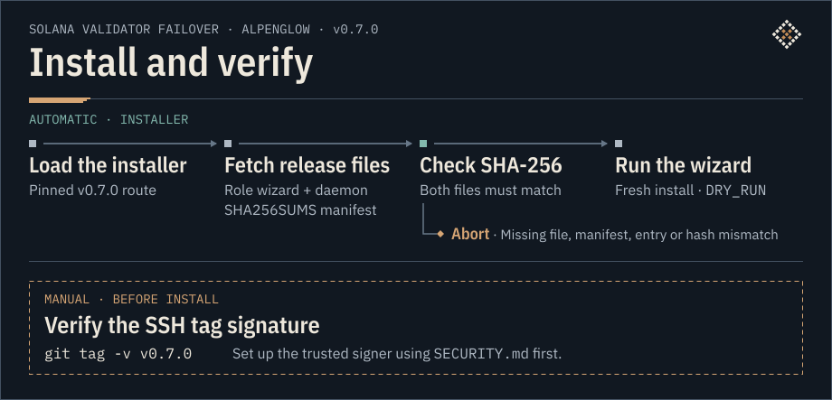

# Solana Validator Failover

[](https://github.com/zimone91/solana-validator-failover/actions/workflows/ci.yml)
[](tests/run_all.sh)
[](.github/workflows/ci.yml)
[](.github/workflows/ci.yml)
[](tests/strace-hermetic.sh)
[](.github/workflows/ci.yml)
<br>
[](https://github.com/zimone91/solana-validator-failover/releases/latest)
[](SECURITY.md)
[](install.sh)
[](#requirements)
[](LICENSE)
<br>
[](docs/SAFETY.md#alpenglow-mode-v07)
[](docs/SAFETY.md#what-has-been-tested)
[](docs/evidence/2026-08-production.md)
[](docs/REFERENCE.md#roadmap)
<br>
[](docs/FAILOVER-OVERVIEW.md#add-a-third-server)
[](docs/NOTIFICATIONS.md)
[](#requirements)

**Two validators, one staked identity — and one rule: never both at once.** You run a primary and a hot spare, and either
can vote with your staked identity. Solana Validator Failover — **FO** below — is one bash daemon per node. A primary that
can see its own trouble steps down by itself. The spare waits out its delay, confirms on up to three RPC tiers, and then pages
you with the swap steps — or, if you armed it, takes the identity itself.

**Author:** [zim.one](https://zim.one) · **Tested on:** agave & Jito-Solana `4.4.0` — the v0.7 release-candidate gate, on the testnet pair; v0.6.x: live failover gate on `4.2.0-rc.0`, ran armed in production on `4.2.1`; earlier releases validated on `3.1.x` / `4.0.x` / `4.1.x` · **Networks:** testnet · mainnet

- **It pages by default and takes only if you arm it.** In Alpenglow mode (v0.7) an unarmed spare never moves the identity: it tells you the identity is free to be moved and what to run.
- **No channel between the nodes.** The two monitors decide independently, each from its own validator and from RPC. Keys stay on their hosts; in a warm swap you move only the vote-history file ([modes and scenarios](docs/FAILOVER-OVERVIEW.md#modes-and-failure-scenarios)).
- **It starts in `DRY_RUN`.** A fresh install logs what it would do and changes nothing until you switch it live ([Go live and arm](#go-live-and-arm)).
- **Bash and systemd, no build step.** One command installs it. The installer checks what it downloads against the tag's `SHA256SUMS`, and the tag is SSH-signed ([Install](#install-one-command)).
- **Its limits are written down.** A node that has gone completely silent cannot be proven incapable of voting from the outside. What that means for you: [Safety model](#safety-model) and [docs/SAFETY.md](docs/SAFETY.md).

**Two words used below.** The *holder* is the node that has the staked identity now. Where the text says *retained*, it means the automatic take of the v0.6.x releases: the code is kept, and v0.7 never runs it.

## What happens when something fails

Measured on a live testnet pair in November 2026, in seconds after the fault. The spare's times include its 60 s delay.

[](docs/img/fo-v07-timeline.svg)

| What fails | The failing node | The spare by default: it pages | The spare when armed: it takes |
|---|---|---|---|
| The holder loses its network | steps down by itself at +36 s on the shipped defaults (+15…+22 s with three connectivity rounds) | page at +72 s | took at +68…+71 s |
| The holder's validator hangs | pages at +8 s and hard-stops the validator at +47 s | page at +71 s | took at +66…+68 s |
| The holder's validator is killed, or its host reboots | comes back on its own unstaked identity | page at +65 s (kill) | took about 70 s after the last vote (reboot) |
| A 20 s network blip on the holder | no demote and no page with the six default connectivity rounds | — | — |
| The spare, the link between the nodes, the external RPC providers or a failover daemon fails | keeps the identity | no takeover page | no take |

By default the spare never moves the identity: its page, `TAKEOVER WITHHELD — Alpenglow mode`, carries what you need for the warm swap.
Every run — the builds, the hardware, and the six defects found live — is in [docs/evidence/2026-11-live-drills.md](docs/evidence/2026-11-live-drills.md).

## How failover works

The holder can self-fence on local signals. The spare checks local RPC, preferred external RPC and a public fallback when needed. Its own final check can veto the handoff.

[](docs/img/fo-v07-flow.svg)

**Alpenglow default:** the spare alerts and the operator performs a warm swap. An armed spare in live mode can take cold when its readiness check passes. Returning to PRIMARY is manual.

**What pages you.** Four channels: **Telegram** (every event, including info), **ntfy or any webhook** (critical and warning pages — they pierce Do-Not-Disturb; Slack/Discord via a JSON template), an **external dead-man’s switch** (healthchecks.io / Uptime Kuma / cronitor — it pages when the monitor itself dies), and the **log** (everything, with the decision traces). A critical page the standby could not deliver to Telegram is re-sent. The named pages: `TAKEOVER WITHHELD — Alpenglow mode`, `STAKED IDENTITY SILENT`, `PRIMARY UNREACHABLE WHILE STAKED`, `HOLDER HUNG — HARD STOP`, `GAVE BACK — unstaked`, `SWITCHED TO UNSTAKED`, `TOOK STAKED`, `[DRY RUN] WOULD TAKE STAKED`, `VALIDATOR VERSION NOT READY`, `TAKEOVER STARVATION`. [Notification matrix](docs/NOTIFICATIONS.md)

[Modes and failure scenarios](docs/FAILOVER-OVERVIEW.md#modes-and-failure-scenarios) · [Live fault tests](docs/FAILOVER-OVERVIEW.md#live-fault-tests) · [Optional third server](docs/FAILOVER-OVERVIEW.md#add-a-third-server) · [Manual return commands](docs/FAILOVER-OVERVIEW.md#manual-return-to-primary)

## What it does

Staked-identity failover **monitor** for Solana validators. **Alpenglow mode (always on in v0.7): FO never takes the
staked identity by itself unless you arm the spare** (`AG_ARMED_TAKE=true`, off by default - below). If your staked node dies or goes silent, the holder fences itself (drops to its own unstaked
identity within ~30s when it can) and the spare — after the same gates as ever: the delay, the external confirmation, the
vote-liveness fence, its own node's view — **pages you** (`TAKEOVER WITHHELD — Alpenglow mode`) with what you need to do the
*warm swap* yourself: demote the old holder, move the vote-history file, then `authorized-voter add` and `set-identity` on the new
one ([docs/SAFETY.md — Alpenglow](docs/SAFETY.md#alpenglow-mode-v07)).

Built safety-first: the failing node **steps down first**, then the spare only **pages you** — the move of the stake is yours
(an unarmed spare, the default; the retained path made it, and an armed spare takes it cold) — and every ambiguous state resolves toward *nobody holds the stake* rather than
two nodes holding it.

- Watches the local validator. If the PRIMARY goes delinquent or isolated, it **self-fences** to its
  own unstaked identity within ~30s; a STANDBY then **pages** you after a cross-node safety delay that the staked identity is
  free to be moved — in Alpenglow mode (v0.7) it takes it itself only when armed (`AG_ARMED_TAKE=true`).
- Detects the failure modes that matter: dead local RPC, frozen slot, **egress-only partition** (own
  votes not landing while the node still looks healthy), and on-chain delinquency. A **hung** staked validator (stopped or deadlocked: its admin socket and RPC mute, its `lastVote` frozen) is
  hard-stopped by its own daemon after `HOLDER_UNREACHABLE_STOP_SECS` (30 s of unreadable identity, plus the reads); any doubt is a page, never a kill.
- An **unstaked** primary (a demoted holder, or any restart) **pages `STAKED IDENTITY SILENT`** when nobody has voted the staked identity for `SILENT_STAKE_PAGE_SECS` (90 s): the spare's host
  is dead, and in Alpenglow mode this node never takes the identity back, so a page is all FO can give. Monitor-only; it needs `VOTE_PUBKEY`.
- **Fails safe by design:** ambiguity resolves toward *unstaked / stop / page the operator*, not toward
  taking the identity. (Design intent — see the residual risks below and in `docs/SAFETY.md`.)

## Requirements

**v0.7 needs agave / Jito-Solana `4.4.0` or newer** (`MIN_VALIDATOR_VERSION`: on an older validator the spare pages `VALIDATOR VERSION NOT READY`).
The `4.2.1` production run above is v0.6.x's, on a validator below that floor; v0.7 itself is being exercised on the testnet pair (the Block 10 end-to-end run).
Those runs, and the test pair's later move to `4.5.0-beta.0`, are listed in [docs/evidence/2026-11-live-drills.md](docs/evidence/2026-11-live-drills.md).

- `agave-validator` (or Jito-Solana), `jq`, `curl`, `systemd`, run as root.
- Two nodes sharing the same **staked** keypair, each with its own **unique unstaked** keypair.
- The installer offers two validator types: `agave`, which covers Jito-Solana, and `frankendancer`, which it marks experimental. Firedancer is not offered.
- The live drills ran on Ubuntu 22.04 and 24.04, on bare metal. CI runs the suites on bash 3.2 and 5.2.

## Install (one command)

```bash
sh -c "$(curl -sSfL https://zim.one/failover/v0.7.0)"
```
[](docs/img/fo-v07-install.svg)

Asks whether this node is PRIMARY or STANDBY, downloads that role's files for the pinned version, verifies them (against the version's `SHA256SUMS` manifest, fail-closed, from the first manifest-bearing release on — `v0.6.9`/`v0.6.10` predate the manifest and are syntax-checked only, which the installer says aloud; no v0.6.x tag is signed), and runs the installer (interactive; starts in DRY_RUN). This tool watches a hot-swap pair and, on its retained path, hot-swaps your staked identity (v0.7 withholds that and pages) — read `install.sh` before running it. The paranoid path (recommended for a root-level tool):

```bash
curl -fsSLO https://raw.githubusercontent.com/zimone91/solana-validator-failover/v0.7.0/install.sh
```
read it, then run `FAILOVER_VERSION=v0.7.0 sh install.sh` (at a tag, `install.sh`'s own default is the release before it — pin the version you downloaded). **What checksums honestly buy you:** detection of a corrupted or truncated download (or a partially applied tag) — not of anyone on the delivery path who rewrites the files and the manifest together: a compromised mirror/CDN, this repository, or zim.one (the manifest travels through the same channel). Details, scope, and disclosure: [SECURITY.md](SECURITY.md).

**Cross-check the two channels:** the route (`curl -sSfL https://zim.one/failover/v0.7.0 | tail -n +2 | sha256sum` — it adds one first line, which `tail` drops) and the raw file at the tag (`curl -sSfL https://raw.githubusercontent.com/zimone91/solana-validator-failover/v0.7.0/install.sh | sha256sum`) must print the same sha256 for `install.sh`, and it is the digest in the [release notes](https://github.com/zimone91/solana-validator-failover/releases/tag/v0.7.0).

Or from source:
```bash
git clone --branch v0.7.0 https://github.com/zimone91/solana-validator-failover
cd solana-validator-failover
sudo bash deploy-failover.sh          # deploy-failover-standby.sh on the spare
```

## Go live and arm

Three separate switches. None of them implies the next:

| Switch | Where | What it turns on | After a fresh install |
|---|---|---|---|
| `DRY_RUN=false` | each node | live mode: the monitor acts instead of only reporting — the holder's self-fence, and on the spare whatever the take switch below permits | `DRY_RUN=true`: it logs what it would do |
| `failover arm` | each node, the holder first | the fence ceremony, opt-in and configured separately from the take switch. On the holder it installs a systemd watchdog fence: if the monitor fails, the validator is demoted or stopped (page-only while `DRY_RUN=true`). On a spare the same failure pages, and the arm takes the holder's pairing token | not armed |
| `AG_ARMED_TAKE=true` | the spare | the cold take: in live mode, and once its readiness check passes, the spare takes the identity itself instead of paging | off: the spare pages |

The interactive installer (on the STANDBY it asks for **Simple** or **Advanced** mode; on the PRIMARY it has no mode prompt) writes `/opt/solana-failover/*.env`, installs
a `systemd` unit, and starts in **DRY_RUN** — it logs what it *would* do and changes nothing. Verify the
logs, then arm (PRIMARY first, then STANDBY). On the **PRIMARY**:
```bash
sed -i 's/DRY_RUN=true/DRY_RUN=false/' /opt/solana-failover/failover.env
systemctl restart solana-failover
```
On the **STANDBY**:
```bash
sed -i 's/DRY_RUN=true/DRY_RUN=false/' /opt/solana-failover/failover-standby.env
systemctl restart solana-failover-standby
```
On a host that has been armed with `failover arm`, `DRY_RUN` is part of the arm state: change it by editing the env file and re-running `failover arm`, not by a `sed` and a restart alone
(see the deployment manual, *Update existing*).

`failover arm` (the fence ceremony) refuses a real arm until `LEDGER_PATH` in the env file names the validator's ledger directory - the fence has no detection of its own - and the monitor unit it installs carries an
`ExecStop=` that re-sends a lost TERM. The standby's take switch is separate: `AG_ARMED_TAKE=false` (the default) only pages; `true` arms the cold take, with `AG_TAKE_MARGIN_SLOTS` (default 200) as its readiness margin and the
pairing rule `TAKEOVER_DELAY` ≥ the holder's `HOLDER_GAP_DEMOTE_SECS` + 30 (shipped 60 ≥ 30 + 30) - [docs/SAFETY.md — Armed cold take](docs/SAFETY.md#armed-cold-take-opt-in-rc1).

## Safety model

> **Prime directive: never let two nodes hold and vote the same staked identity (double-sign).**
> Everything below serves that goal; the honest limits of the current implementation follow it.
>
> **v0.7, Alpenglow mode:** the take-side bullets below describe the *retained* take path — what the same gates guard — which v0.7 never runs. Unarmed (the default,
> `AG_ARMED_TAKE=false`), a take every gate approves is **withheld and paged**, and paged again at most once per `ALERT_THROTTLE` while the same episode lasts ([docs/SAFETY.md — Alpenglow](docs/SAFETY.md#alpenglow-mode-v07)); armed
> (`AG_ARMED_TAKE=true`), the standby takes it cold, voter first, once the readiness margin also holds ([Armed cold take](docs/SAFETY.md#armed-cold-take-opt-in-rc1)). The gates stay
> because they decide *when the page is sent, or the take made*, and the code is the base for a later release.

- The PRIMARY **relinquishes first** (self-fences to unstaked) before any spare can take.
- The STANDBY takes only after `TAKEOVER_DELAY` (default **60s** = the PRIMARY's ~30s self-fence + a 30s
  cross-node margin, which is also the sum that pairs with the holder's gap rule: `TAKEOVER_DELAY` ≥ `HOLDER_GAP_DEMOTE_SECS` 30 + 30) **and** a vote-liveness check that the previous holder's vote account has stopped
  advancing. A hand-edited delay below the safe floor **refuses to start**.
- The automatic take of the TowerBFT era (`set-identity` on the spare, ~60s) is the *retained path*: kept in the code as the base for a later release, unreachable in v0.7, and marked as such wherever this README describes it. What an **armed** spare runs instead is the *cold take*: `authorized-voter add` first, then `set-identity` with the vote-history requirement switched off, once a readiness margin also holds ([docs/SAFETY.md — Armed cold take](docs/SAFETY.md#armed-cold-take-opt-in-rc1)).
- When the external RPCs are not observable the gates hold for as long as the blindness lasts (by design: unobservable time counts as life) and the operator is paged (`TAKEOVER_STARVATION_ALERT_SECS`, default 300s).
- A promoted STANDBY (an unarmed spare never promotes itself; an armed one does, by the cold take) that later isolates self-fences too, with a 600s re-take lockout.

#### How safe is it — honestly

The failing node fences **itself** (dead RPC, frozen slot, or its own votes not landing) and drops to an
unstaked identity within ~30s. Only then, after a 60s floor plus an on-chain check that the vote account
really stopped, does the spare page you that the identity is free to be moved (v0.7: an unarmed spare never moves it itself, an armed one takes it cold; the take it used to make
is the retained path). Live-tested end to end on testnet (the retained path): [test evidence](docs/SAFETY.md#what-has-been-tested).

The honest limit: a node that has gone **completely silent** cannot be proven incapable of voting — it
might be wedged, or partitioned and still signing where you can't see it. Detecting that from the
outside is impossible in principle; it has to be *made* true by fencing the old host. That fence is v0.7's
`failover arm` ceremony, holder-side and opt-in; the spare's relinquish-proof gate that would condition a take on it is not wired in this release
(see *This release has no relinquish-proof gate* in the long form below). Run a `DRY_RUN` soak on your own stack first, and read
[docs/SAFETY.md](docs/SAFETY.md) before pointing this at a mainnet identity you care about.

**Where the strength comes from.** The protection is strongest where the failing node can detect its
own trouble and step down — which covers dead RPC, a stalled slot, and an egress-only partition where
its votes stop landing. For a node that has gone *completely* silent, "stopped voting" is evidence
rather than proof; v0.7 adds a watchdog so a node that can no longer confirm it owns the identity
stops itself. Detail: [docs/SAFETY.md](docs/SAFETY.md) · [docs/SPLIT-BRAIN-RESIDUAL.md](docs/SPLIT-BRAIN-RESIDUAL.md).

<details>
<summary><b>The long form:</b> the cross-node ordering and its measured timing, two named residuals, and the relinquish-proof gate this release does not have</summary>

- The last read before the
  take is the spare's **own** node (v0.7): one bounded read (`curl -m 2` + a watchdog pet) that
  withdraws the take if its own node shows the holder voting, cannot answer, or is not advancing; the
  spare also samples its own head through the episode and before each external read of the take cycle
  — five to twelve bounded local reads per take cycle at the defaults (one more on an armed unit, up to
  four more with the opt-in witness fast path), milliseconds on a healthy node (harness measurements on a v0.7 development build, not pinned by a test: +9 to
  +15 s when every local read takes 1 s with prompt tiers, up to +40 s in the measured cells with a slow
  tier as well; as a local read nears its 2 s bound the take slides later, and at 2 s or more the spare
  never takes — loudly: the veto page, then the starvation page). How that ordering holds up per failure
  class, measured, including where it does not:
  [docs/SAFETY.md — the cross-node invariant](docs/SAFETY.md#the-cross-node-invariant).
- Two named residuals of that own view ([docs/SAFETY.md — the spare's own view](docs/SAFETY.md#the-spares-own-view-v07-block-631),
  residuals 6 and 7). **The mirror world** (Block 6.3's too): with `TIER2` splicing or lagging (showing the
  holder frozen) while the spare's own node lags as well, a holder that resumed within that lag is taken
  while it votes — up to the lag the spare's own `--health-check-slot-distance` admits at the take cycle's
  Tier-1 check (128 slots by default, up to ≈ 51 s: the distance ÷ the cluster's slot rate, taken at the slowest rate of the slot-params table, 2.5 slots/s — about 27 s at Alpenglow's measured 4.667; a lag
  that grows during a slow take cycle is not bounded by it), so a lower distance on the spare's validator
  narrows it. **The starvation** — introduced by Block 6.3.1's own-view veto, an availability regression (never a
  double-sign): Block 6.3 has no veto and takes these holders. A `TIER2` that fails slowly — times out, or answers
  an error or garbage late — while `TIER3` is slow (`TIER2`'s time to failure + `TIER3`'s answer + both local reads
  past 16 s: after a timeout, `TIER3` 7 s or more, 5 s when local reads take 1 s) leaves the veto no fresh own-head
  baseline, so a dead holder is never taken over, loudly — the veto page
  `⚠️ Take VETOED by this spare's own view (it could not testify): …`, then the starvation page
  `⚠️ TAKEOVER STARVATION: …` (on a real host one second less is vetoed too, at some phases) — repair that
  `TIER2`, or while it is broken leave `TIER2_RPC` empty (an armed spare with
  `PRIMARY_UNSTAKED_PUBKEY` set then pages "G2 VANTAGES NOT DISTINCT" at every start — verified-demote cannot
  prove for the run once the gate is wired, and conditions no take in this release — unless `G2_VANTAGE_A` names
  another provider), or use a `TIER3`
  that answers the full `getVoteAccounts` well under ~5 s (about 3 s when local reads take 1 s); a `TIER2`
  that refuses at once does not starve the take.
- **This release has no relinquish-proof gate:** armed or not, the spare's take follows the v0.6.x semantics,
  which the 6.3 re-check and the own-view veto can only hold — no provider's verdict conditions any take. An armed
  spare that is not paired (or is paired with an invalid or page-only token) pages `ARMED SPARE NOT ATTESTED 🚨`
  at every start: arm the holder first and copy its token, because from the release that wires the gate (Block
  6.4) an unpaired or invalidly paired spare's silence-based take is disabled — and an unpaired spare with no other
  provider configured (no `PRIMARY_UNSTAKED_PUBKEY`, or G2 disabled by its vantage check) takes nothing at all. A
  `fence=page-only` token means the holder was armed without its real fence (fix: `DRY_RUN=false` on the holder, then
  `failover arm` there); a `TAKEOVER_DELAY` raised after pairing makes the pairing INVALID, and re-pairing is refused
  until the holder's bounds cover it (the arm prints both fixes). That gate will decide *how* the old
  holder is known to be gone; its providers already run on an armed spare. The strongest proof is
  **verified-demote (G2)**: the holder's *unstaked* identity observed in gossip at the staked identity's exact
  endpoint, and still there ≥60s later on two pinned RPC
  vantages from distinct failure domains — a positive "the demoted state is live *now*", not an absence
  guess. Each snapshot is one JSON-RPC batch, so the freshness anchor (the vantage's own confirmed
  slot) rides *inside* the response that carries the proof: cached and replayed vantage data reads as
  *cannot-determine*, never as proof. `failover arm` refuses to arm a spare whose vantages cannot serve
  that batch, or whose two vantage names resolve to one address. By default those vantages *are*
  `TIER2_RPC`/`TIER3_RPC` — the same endpoints the vote-liveness check reads — and on such a host one
  compromised vantage can supply both halves of a double-sign; the arm measures that, says so, and
  recommends a third endpoint in a separate failure domain. What each layer does and does **not**
  catch — including an active protocol-aware intermediary, which it does not — is enumerated in
  [`docs/SAFETY.md`](docs/SAFETY.md). Un-armed hosts see none of this.

```
PRIMARY ──self-fence ~30s──►  STANDBY ──pages at 60s──►  BACKUP
holds staked, steps down       pages: the swap is yours  (pages at 120s, only if STANDBY is also down)
                               (retained path: took the staked identity — not run in v0.7)
```

A spare's page (the take that Alpenglow mode withholds) also waits for its own-view reads (milliseconds on a healthy node; harness measurements on a v0.7 development build, not pinned by a test: +9 to +15 s
when every local read takes 1 s with prompt tiers, up to +40 s in the measured cells with a slow tier as
well; a spare whose local reads take 2 s or more never sends it, and pages the veto instead — so does one whose `TIER2` fails
slowly (times out, or answers an error late) while `TIER3` is slow, the starvation above) after the delays
shown. Once every gate has said take, the page itself reads the node's own RPC five times (3 s each) and hashes the vote-history file
(bounded at 12 s): up to about 27 s at the decision point, milliseconds on a healthy node.
Details and the residual-risk analysis: [docs/SAFETY.md](docs/SAFETY.md).

</details>

## ⚠️ Before you point this at a mainnet identity

- **Not for unattended mainnet yet** — see “How safe is it — honestly” above: the fence is opt-in (`failover arm`) and the relinquish-proof
  gate is not wired in this release. Run `DRY_RUN`, testnet, or keep a human in the loop to fence the old node before promotion.
- **Test on testnet first** — DRY_RUN soak, then a live failover on a testnet stack.
- In v0.7 this tool never moves your staked identity between machines **by itself** unless you arm a spare (`AG_ARMED_TAKE=true`, Alpenglow mode); its retained path did, and a later
  release may. Never aim `STAKED_KEYPAIR` at an identity you can't afford to have hot-swapped.
- **Each node needs its own unique unstaked keypair** — a shared unstaked pubkey breaks the fence.
- **Point `VOTE_PUBKEY` at *your* vote account** — the one whose `nodePubkey` is your staked identity.
  The release does not yet verify that binding; a wrong vote account silently misleads the fence.
- Roll out **one node at a time**; leave the advanced gossip fast-path (Option A) **off** until you've
  watched the timer path in production for a while.

## Tests

```bash
cd tests && bash run_all.sh
```
65 suites, parse-clean on bash 3.2+ (CI runs them on both bash 3.2 and 5.2). They drive the real self-fence / takeover / timing functions with
mocked I/O, and each safety fix ships with a control that fails when the fix is reverted. At the syscall level, `tests/strace-hermetic.sh`
(CI's strace job, ubuntu-24.04) fails on any inet socket in the whole run. These are function-level tests — they do **not** prove cross-process
ordering between two live systemd services; the live runs on the test pair are in [docs/FAILOVER-OVERVIEW.md](docs/FAILOVER-OVERVIEW.md#live-fault-tests),
and the harness in detail is in [docs/REFERENCE.md](docs/REFERENCE.md#tests).

The live runs on real validators since June 2026 — 58 of them: 52 with an induced fault, 4 soaks and 2 planned swaps, including the ones that failed — are in [docs/evidence/2026-11-live-drills.md](docs/evidence/2026-11-live-drills.md).

## Notifications

Telegram + [ntfy.sh](https://ntfy.sh) push + an external "dead-man's switch" watchdog
(healthchecks.io / Uptime Kuma / cronitor) that pages you if the monitor process itself dies.
See [docs/NOTIFICATIONS.md](docs/NOTIFICATIONS.md).

## Verify the claims, not the adjectives

- [SECURITY.md](SECURITY.md) — disclosure contact; what runs as root; what verification does and does not give you.
- [docs/audits/](docs/audits/) — every audit round, including the one that made us retract a public overclaim and the NO-GO verdict. Each finding shipped with a control test that fails if the fix is reverted.
- [docs/evidence/](docs/evidence/) — armed-production evidence: a real unplanned mainnet failover (2026-08-10, every gate logged) *and* the incident from the same fleet, because evidence cuts both ways; and [every live run, June to November 2026](docs/evidence/2026-11-live-drills.md): 58 runs — 52 with an induced fault, 4 soaks and 2 planned swaps — including the ones that failed.
- [CI](.github/workflows/ci.yml) runs the full suite on bash 3.2 **and** 5.2 on pushes to `main` and on pull requests — the 5.2 job exists because a real interpreter bug shipped and was invisible to a single-interpreter suite.

## Questions and feedback

A question, a setup this does not cover, a place where you think the safety model is wrong: open an [issue](https://github.com/zimone91/solana-validator-failover/issues).
Mask identities and never paste a keypair or a bot token. A vulnerability goes the way [SECURITY.md](SECURITY.md) describes, not into a public issue.

## Full reference

- [docs/REFERENCE.md](docs/REFERENCE.md) — the Quickstart in full, the configuration knobs and the fence self-check, the test harness in detail, the roadmap (moved off this page on 2026-11-10, text as at v0.7.0).
- [docs/FAILOVER-OVERVIEW.md](docs/FAILOVER-OVERVIEW.md) — the operator overview: live fault tests, modes and failure responses, the optional third server, the manual return.
- [docs/DEPLOYMENT-MANUAL.md](docs/DEPLOYMENT-MANUAL.md) · [docs/SAFETY.md](docs/SAFETY.md) · [docs/NOTIFICATIONS.md](docs/NOTIFICATIONS.md) · [SECURITY.md](SECURITY.md) · [CHANGELOG.md](CHANGELOG.md)

## License

[MIT](LICENSE) © [zim.one](https://zim.one)
