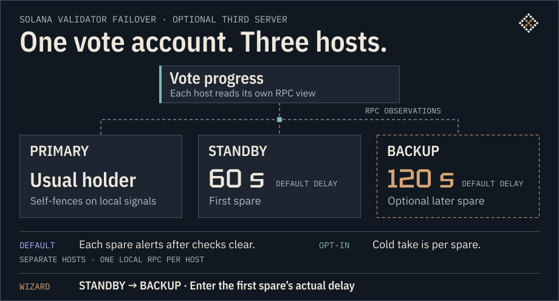
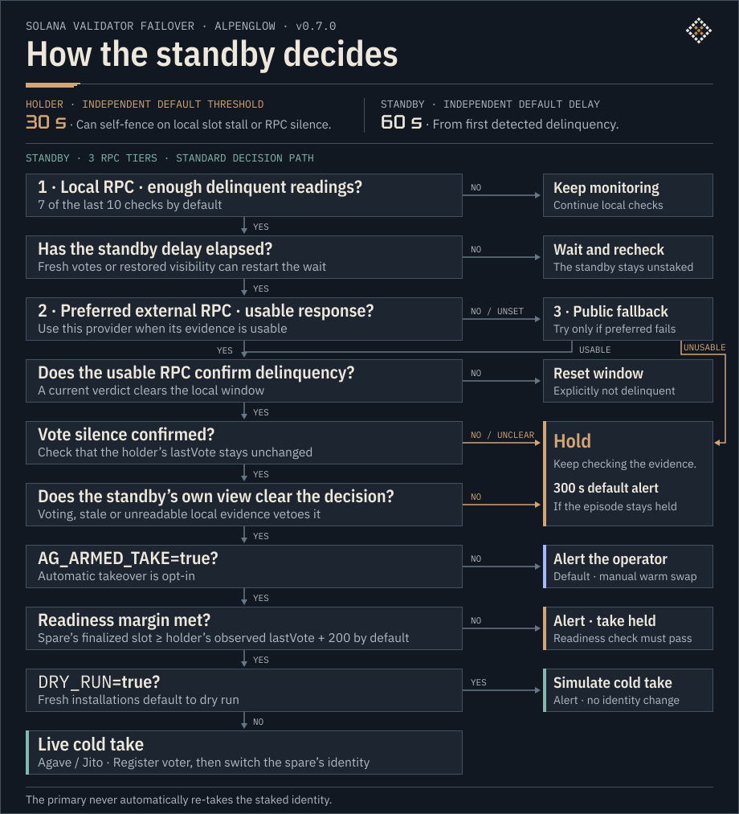
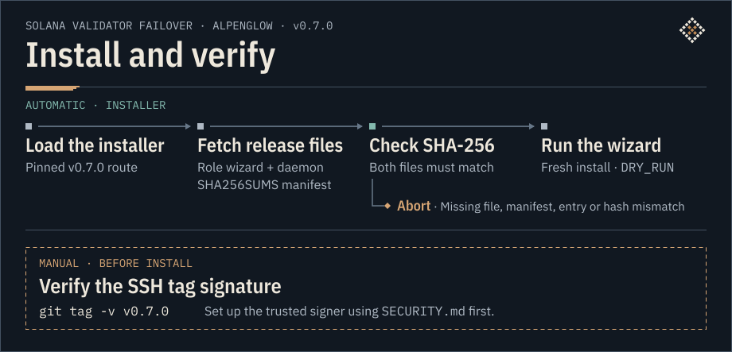

# Failover overview · v0.7.0

**The holder can step down. The spare checks three RPC tiers before it can take over.**

[](img/fo-v07-flow.svg)

**How long?** 30/60/120 s are independent thresholds or presets. Observation and RPC checks add time. The default path then waits for the operator’s warm swap. Confirm voting from the new holder’s logs and an advancing `lastVote`. [Timing model](https://github.com/zimone91/solana-validator-failover/blob/v0.7.0/README.md#L132-L138)

[Live fault tests ↓](#live-fault-tests) · [Modes and scenarios ↓](#modes-and-failure-scenarios) · [Add a third server ↓](#add-a-third-server) · [Full decision tree ↓](#full-decision-tree) · [Install ↓](#install-and-verify) · [Manual return ↓](#manual-return-to-primary)

## Live fault tests

**Alpenglow testnet · Agave 4.4.0 and Jito-Solana 4.4.0-jito.** The v0.7 candidates ran on a live validator pair. [Test scope](https://github.com/zimone91/solana-validator-failover/blob/v0.7.0/README.md#L20-L23)

- **20 s network isolation.** Three failed connectivity checks triggered self-fencing at **+17 s**. With six checks, the shipped default, the repeat produced no demotion or alert. [Tagged changelog](https://github.com/zimone91/solana-validator-failover/blob/v0.7.0/CHANGELOG.md#L45-L49)
- **151 s `SIGSTOP`.** The earlier monitor paged once and the holder resumed voting on `SIGCONT`. This led to a conditional hard stop for a verified hung primary. [Hung-holder drill](https://github.com/zimone91/solana-validator-failover/blob/v0.7.0/docs/SAFETY.md#L131-L138)
- **Deliberate duplicate identity.** Agave detected the duplicate at **6.0 s** and the original holder exited at **7.9 s**. The nodes cast **29 identical votes** during the overlap — duplicates, not conflicting votes. [Client behavior drill](https://github.com/zimone91/solana-validator-failover/blob/v0.7.0/docs/SAFETY.md#L158-L163)

**TowerBFT mainnet · v0.6.9.** On 10 August 2026 an unplanned host outage triggered takeover **60 s after the countdown anchor**. Voting resumed on the spare. [Production record](https://github.com/zimone91/solana-validator-failover/blob/v0.7.0/docs/evidence/2026-08-production.md#L8-L19)

**Alpenglow mainnet · deployment at release.** We ran FO v0.7.0-rc2 on Jito-Solana 4.4.1 with holder monitoring and self-fencing enabled and the standby in alert mode. The final tag’s daemons differ from rc2 only in the version string. [Tag changes](https://github.com/zimone91/solana-validator-failover/blob/v0.7.0/CHANGELOG.md#L28-L30)

**CI · 65 suites.** The final-tag run passed on Bash 3.2 and 5.2. The suites exercise decision functions with mocked I/O; seven older controls that compare against a previous release’s file print `SKIP` instead of passing. A separate `strace` job checks for zero IPv4/IPv6 socket calls. [CI run](https://github.com/zimone91/solana-validator-failover/actions/runs/42553129969) · [Test scope and limits](https://github.com/zimone91/solana-validator-failover/blob/v0.7.0/README.md#L219-L232)

**Every recorded run, including the ones that failed.** [Live runs, June to November 2026](evidence/2026-11-live-drills.md): 58 runs — 52 with an induced fault, 4 soaks and 2 planned swaps — with builds, hardware and the defects they found.

<details>
<summary>Earlier v0.6 field tests and operating evidence</summary>

| Test or observation | Result |
| --- | --- |
| Holder’s local RPC isolated | Self-fenced after about 31 s of observed silence. The spare took over on its timer. |
| Holder’s outbound UDP cut | Continued receiving blocks, then self-fenced with 82–98 slots of vote lag sustained for about 20–23 s. |
| Promoted spare isolated | Self-fenced and refused re-take during the 600 s lockout. |
| Holder monitor restarted | Voting continued with no false demote despite a stale baseline. |
| Armed monitor loop | 3.12–3.33 s per cycle at a 3 s interval, measured across four nodes including two on mainnet. |
| Mainnet manual return on an unexpected identity | The monitor’s routine warning was upgraded to critical paging after the incident. |

[Observed fault tests](https://github.com/zimone91/solana-validator-failover/blob/v0.7.0/docs/SAFETY.md#L377-L408) · [Production cadence and failback incident](https://github.com/zimone91/solana-validator-failover/blob/v0.7.0/docs/evidence/2026-08-production.md#L21-L49)

</details>

## Modes and failure scenarios

- **Local-first.** Routine checks use each node’s own RPC. The monitors make independent decisions without a direct channel between hosts. The **7-of-10** window filters brief changes in observed delinquency. During a warm swap, the operator transfers only the vote-history file. Keys stay on their hosts. [Detection and veto](https://github.com/zimone91/solana-validator-failover/blob/v0.7.0/docs/SAFETY.md#L354-L375) · [Warm swap](https://github.com/zimone91/solana-validator-failover/blob/v0.7.0/docs/SAFETY.md#L54-L64)
- **Operator escalation.** **90 s** of observed vote silence can page from an unstaked primary. **300 s** from first delinquency can page from a spare if the episode is still held. Both are alerts. [Silent stake](https://github.com/zimone91/solana-validator-failover/blob/v0.7.0/CHANGELOG.md#L39-L43) · [Held takeover](https://github.com/zimone91/solana-validator-failover/blob/v0.7.0/solana-standby-failover.sh#L2623-L2655)

<details>
<summary>Operator settings, failure responses and safety limits</summary>

### Controls and defaults

| Control | Effect in v0.7.0 |
| --- | --- |
| `LOCAL_RPC`, `TIER2_RPC`, `TIER3_RPC` | Routine checks are local, with periodic external probes. For external confirmation and vote-liveness evidence, prefer Tier 2. Use public Tier 3 when Tier 2 is unusable or unset. |
| `AG_ARMED_TAKE` | `false` by default. When checks clear, `TAKEOVER WITHHELD` prompts a manual warm swap. `true` permits cold takeover with the readiness check and live mode. |
| `AG_TAKE_MARGIN_SLOTS` | Spare finalized slot minus holder’s last observed `lastVote` must reach **200 slots** by default. Short or missing evidence holds and pages. |
| `DRY_RUN` | Fresh install: `true`, report decisions without changing identity. A qualifying armed spare reports `WOULD TAKE STAKED`. `false` enables permitted actions and leaves the separate takeover switch as configured. |
| `TAKEOVER_DELAY`, `STANDBY_TAKEOVER_DELAY` | Standby **60 s**, backup preset **120 s**. Fresh votes or a blind interval can re-anchor the delay. BACKUP needs the first spare’s actual delay to calculate its timing floor. |
| `SILENT_STAKE_PAGE_SECS`, `TAKEOVER_STARVATION_ALERT_SECS` | **90 s** of observed vote silence on an unstaked primary and **300 s** from first delinquency in an unresolved spare episode. Separate alert clocks. |
| `PRIMARY_SELF_FENCE`, `failover arm` | Local self-fencing is enabled by default. `failover arm` configures systemd watchdog fencing separately from `AG_ARMED_TAKE`. |
| `VOTE_LIVENESS_VERIFY`, `GOSSIP_VERIFY`, `WITNESS_FASTPATH` | Compare votes from one provider while its cluster tip advances. Any fresh vote blocks by default. Gossip is advisory. An opt-in corroborated witness can shorten the countdown while preserving liveness and veto checks. |
| `RECOVERY_MODE`, `GIVE_BACK_MODE` | Alpenglow stays on. Returning to PRIMARY is a manual warm swap. |

[RPC cost model](https://github.com/zimone91/solana-validator-failover/blob/v0.7.0/docs/DEPLOYMENT-MANUAL.md#L154-L168) · [Defaults](https://github.com/zimone91/solana-validator-failover/blob/v0.7.0/failover-standby.env.example#L38-L89) · [Vote evidence](https://github.com/zimone91/solana-validator-failover/blob/v0.7.0/failover-standby.env.example#L150-L164) · [Witness setup](https://github.com/zimone91/solana-validator-failover/blob/v0.7.0/failover-standby.env.example#L200-L226) · [Watchdog setup](https://github.com/zimone91/solana-validator-failover/blob/v0.7.0/systemd/README.md)

### Failure responses

| What FO sees | Response |
| --- | --- |
| Fewer than **7 of 10** delinquent readings | Keep watching. |
| Frozen confirmed slot or silent local RPC | Holder can self-fence at **30 s**. Spare timing is independent. |
| Blocks arrive but votes stop landing | Holder can self-fence at more than **32 slots** of vote lag for **20 s**. Alpenglow VAT exclusion withholds vote-based demotion and pages. Partition triggers still apply. |
| Previously staked holder stays unreadable | At **30 s**, check for the same process, silent local RPC and frozen votes while the cluster advances. Hard-stop only if the evidence clears. Ambiguity pages. |
| External confirmation says holder is current | Clear the window and return to monitoring. |
| External RPCs are blind, votes advance or the local view vetoes | Hold. Blindness or renewed votes can restart the countdown. |
| Checks clear in default mode | Page with `lastVote`, cluster tip and provider, spare health and version, VAT admission, vote-history status and hash if readable, and warm-swap guidance. Verify the old holder relinquished before moving the identity. |
| Armed with enough margin | In live mode, load the authorized voter before switching identity. In dry-run, report the simulated action. A short or unreadable margin holds, pages and can be checked again. |
| Promoted spare later isolates | It can self-fence and enters a **600 s** re-take lockout that survives monitor restarts. |
| Unstaked primary sees votes frozen while the cluster advances | `STAKED IDENTITY SILENT` pages after the configured span when `VOTE_PUBKEY` is set. |

[Failure directions](https://github.com/zimone91/solana-validator-failover/blob/v0.7.0/docs/SAFETY.md#L354-L375) · [VAT and page contents](https://github.com/zimone91/solana-validator-failover/blob/v0.7.0/docs/SAFETY.md#L28-L45) · [Hung holder and silent stake](https://github.com/zimone91/solana-validator-failover/blob/v0.7.0/docs/SAFETY.md#L131-L146)

**Before going live.** Match `VOTE_PUBKEY` to the staked identity’s vote account. FO relies on the operator to verify that binding. Vote silence is evidence. v0.7.0 has a holder-side watchdog, with external fencing and the spare’s relinquish-proof gate outside the active takeover path. [Setup checks](https://github.com/zimone91/solana-validator-failover/blob/v0.7.0/README.md#L234-L245) · [Safety limits](https://github.com/zimone91/solana-validator-failover/blob/v0.7.0/docs/SAFETY.md#L427-L453)

**Alert delivery.** Critical and warning pages can go to Telegram and ntfy/webhook. Info goes to Telegram and logs. An external heartbeat checks monitor liveness separately. [Notification matrix](https://github.com/zimone91/solana-validator-failover/blob/v0.7.0/docs/NOTIFICATIONS.md#L9-L33)

**Additional checks.** A promoted standby checks for duplicate identity every **60 s** and can page after two consecutive gossip mismatches. An armed holder checks its fence state every **60 s**. v0.7 uses monotonic safety timers and atomic state writes. [Standby defaults](https://github.com/zimone91/solana-validator-failover/blob/v0.7.0/failover-standby.env.example#L127-L145) · [Fence self-check](https://github.com/zimone91/solana-validator-failover/blob/v0.7.0/docs/SAFETY.md#L455-L475) · [Timer and state changes](https://github.com/zimone91/solana-validator-failover/blob/v0.7.0/docs/SAFETY.md#L616-L621)

</details>

## Add a third server

BACKUP watches the same vote account from its own host. While STANDBY is voting as holder, BACKUP keeps watching. If those votes stall, BACKUP uses its own RPC view and delay.

[](img/fo-v07-backup.svg)

1. Run the pinned installer on each host. On the third host select **STANDBY → BACKUP**. [Role menu](https://github.com/zimone91/solana-validator-failover/blob/v0.7.0/install.sh#L59-L76) · [Spare wizard](https://github.com/zimone91/solana-validator-failover/blob/v0.7.0/deploy-failover-standby.sh#L290-L344)
2. Set the same `VOTE_PUBKEY` and provision the shared staked identity locally. Each host boots with its own unstaked key and points `LOCAL_RPC` at its own validator. Configure distinct external tiers on the same cluster. [Keys and RPCs](https://github.com/zimone91/solana-validator-failover/blob/v0.7.0/deploy-failover-standby.sh#L430-L469)
3. Enter STANDBY’s actual `TAKEOVER_DELAY` as `STANDBY_TAKEOVER_DELAY`. The wizard raises the **120 s** BACKUP preset when required by the timing floor. Its live cold take remains a per-spare opt-in and goes through the same evidence checks. [Timing floor](https://github.com/zimone91/solana-validator-failover/blob/v0.7.0/deploy-failover-standby.sh#L613-L642) · [Modes](#modes-and-failure-scenarios)

## Full decision tree

<details>
<summary>Open every yes / no branch</summary>

[](img/fo-v07-decision-tree.svg)

</details>

## Install and verify

Runs on Bash and systemd with no build step. Requires Agave or Jito-Solana **4.4.0+**, `jq` and `curl`. Run the pinned wizard as root. Fresh installs start with `DRY_RUN=true`. [Requirements and installation](https://github.com/zimone91/solana-validator-failover/blob/v0.7.0/README.md#L140-L190)

```sh
sh -c "$(curl -sSfL https://zim.one/failover/v0.7.0)"
```

<details>
<summary>Installer flow, verification and rehearsal</summary>

[](img/fo-v07-install.svg)

- **Verify the source.** Check the SSH-signed tag with Git and the trusted signer. Review the tagged installer and use `FAILOVER_VERSION=v0.7.0 sh install.sh` if running it directly. [Tagged installer](https://github.com/zimone91/solana-validator-failover/blob/v0.7.0/install.sh) · [Signing instructions](https://github.com/zimone91/solana-validator-failover/blob/v0.7.0/SECURITY.md#L46-L75)
- **Verify the download.** The pinned loader aborts if the manifest or a required checksum is missing or mismatched. The tagged `install.sh` and the pinned route with its first line removed should hash to the value below. Manifest checks verify file integrity. The signed tag verifies provenance. [Compare the channels](https://github.com/zimone91/solana-validator-failover/blob/v0.7.0/README.md#L150-L157)

```text
18009987574bd848c2116f44a6fba186468cb10221e51aaa6e4ff880ecf3e90f
```

- **Rehearse on a spare or test pair.** `DRY_RUN` applies to monitor actions. A fault you inject is still real. The wizards reject invalid yes/no answers and default to No for reusing an existing environment. They reject a detected staked startup identity unless explicitly overridden. [Wizard changes and rehearsal](https://github.com/zimone91/solana-validator-failover/blob/v0.7.0/CHANGELOG.md#L16-L30) · [Startup identity guard](https://github.com/zimone91/solana-validator-failover/blob/v0.7.0/deploy-failover-standby.sh#L404-L424)

</details>

## Manual return to primary

The operator returns the staked identity from STANDBY or BACKUP with an Alpenglow warm swap. Before the swap, check that PRIMARY is caught up and running on its own unstaked identity. A v0.7 hard stop leaves the validator unit stopped. Start it on its configured unstaked identity and let it catch up. Keep each host’s startup identity unstaked and verify that `AG_ARMED_TAKE=false` is effective on all spares for the maintenance window, including the current holder after demotion. [Switch-back procedure](https://github.com/zimone91/solana-validator-failover/blob/v0.7.0/docs/DEPLOYMENT-MANUAL.md#L912-L960) · [Startup identity](https://github.com/zimone91/solana-validator-failover/blob/v0.7.0/docs/DEPLOYMENT-MANUAL.md#L221-L242) · [Arming mode](https://github.com/zimone91/solana-validator-failover/blob/v0.7.0/docs/SAFETY.md#L92-L98)

1. **Demote the current holder.** Remove the loaded voters, switch to that host’s own unstaked identity, then verify the local identity.
2. **Transfer verified vote history.** Compare two matching source SHA-256 hashes five seconds apart. Copy only the history file to PRIMARY’s ledger, then compare its hash there with the source.
3. **Promote PRIMARY and verify voting.** Add the authorized voter before switching to the staked identity. Check both hosts’ identities, PRIMARY’s vote logs and advancing `lastVote` before ending maintenance.

<details>
<summary>Show the warm-swap commands</summary>

Set `AGAVE_VALIDATOR`, `LEDGER_DIR`, `STAKED_IDENTITY` and `UNSTAKED_IDENTITY` to the actual binary, ledger and keypair paths on each host. On the current holder, also set `PRIMARY_SSH` to PRIMARY’s SSH target and `PRIMARY_LEDGER_DIR` to its ledger path. These commands use the FO setup where the staked identity keypair is also the authorized voter. The history filename uses the staked **identity** pubkey. Use the **vote account** pubkey for vote checks. [Vote history and warm swap](https://github.com/zimone91/solana-validator-failover/blob/v0.7.0/docs/SAFETY.md#L54-L64)

**1 · Current holder.** `&&` stops the pair if the voter command fails. Before continuing, verify the host’s own unstaked identity with `"$AGAVE_VALIDATOR" --ledger "$LEDGER_DIR" contact-info`.

```bash
"${AGAVE_VALIDATOR:?}" --ledger "${LEDGER_DIR:?}" authorized-voter remove-all &&
  "$AGAVE_VALIDATOR" --ledger "$LEDGER_DIR" set-identity "${UNSTAKED_IDENTITY:?}"
```

**2 · Current holder, then PRIMARY.** Start on the old holder. Continue to `scp` after its two SHA-256 hashes match.

```bash
STAKED_PUBKEY=$(solana-keygen pubkey "${STAKED_IDENTITY:?}") &&
  HISTORY_FILE="${LEDGER_DIR:?}/vote_history-${STAKED_PUBKEY:?}.bin" &&
  sha256sum -- "$HISTORY_FILE" && sleep 5 && sha256sum -- "$HISTORY_FILE"
```

```bash
scp "${HISTORY_FILE:?}" "${PRIMARY_SSH:?}:${PRIMARY_LEDGER_DIR:?}/"
```

On PRIMARY, check that the copied file has the same SHA-256 before promoting.

```bash
STAKED_PUBKEY=$(solana-keygen pubkey "${STAKED_IDENTITY:?}") &&
  sha256sum -- "${LEDGER_DIR:?}/vote_history-${STAKED_PUBKEY:?}.bin"
```

**3 · PRIMARY.** Plain `set-identity` requires the saved Alpenglow vote history. If `authorized-voter add` returns `Authorized voter already present`, verify that it refers to the expected keypair before running `set-identity` separately. On any other error or timeout, stop and check local state before retrying. [Agave history requirement](https://docs.anza.xyz/operations/guides/validator-failover#changes-for-alpenglow) · [Agave voter handling](https://github.com/anza-xyz/agave/blob/v4.4.0/validator/src/admin_rpc_service.rs#L926-L942)

```bash
"${AGAVE_VALIDATOR:?}" --ledger "${LEDGER_DIR:?}" authorized-voter add "${STAKED_IDENTITY:?}" &&
  "$AGAVE_VALIDATOR" --ledger "$LEDGER_DIR" set-identity "$STAKED_IDENTITY"
```

Run `contact-info` again on both hosts. PRIMARY should show the staked identity and the old holder its own unstaked identity. Confirm votes in PRIMARY’s logs and check that `lastVote` advances across fresh RPC reads for the vote account. [FO identity verification](https://github.com/zimone91/solana-validator-failover/blob/v0.7.0/solana-standby-failover.sh#L768-L779) · [Solana getVoteAccounts](https://solana.com/docs/rpc/http/getvoteaccounts)

</details>

## Project history

**4 Mar 2026** · Earlier work came together in an archived primary and standby build, installers and runbook. **28 Jun** · Earliest dated live testnet drill in the project records. **5 Jul** · [First public release, v0.6.9](https://github.com/zimone91/solana-validator-failover/releases/tag/v0.6.9). **10 Aug** · [Unplanned mainnet takeover](https://github.com/zimone91/solana-validator-failover/blob/v0.7.0/docs/evidence/2026-08-production.md#L8-L19) on v0.6.9 under TowerBFT. **9 Nov** · Signed v0.7.0 tag for Alpenglow.
